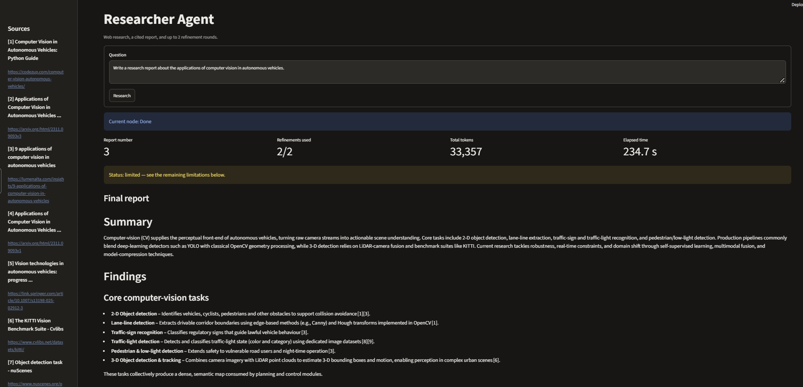
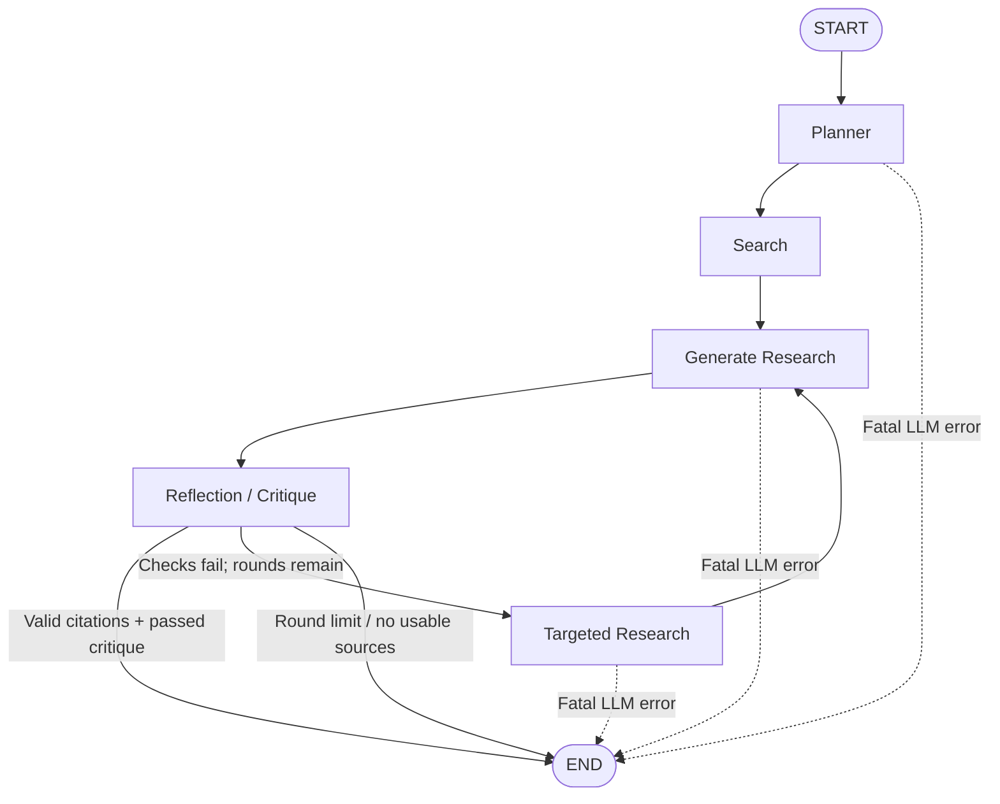

# Researcher Agent

A Python research assistant that turns a question into a cited report through web search, self-critique, and bounded refinement.

## What it does

- Plans a scope, subquestions, and 3–4 web searches.
- Searches and reads HTML pages through a custom local MCP server.
- Writes a Markdown report with numbered citations, critiques its evidence and coverage, and performs targeted research.
- Stops when all quality checks pass or after two refinement rounds, returning `success` or `limited` with explanations.

## App preview



## Architecture



There are exactly five workflow nodes. Every report gets a fresh critique before the conditional stopping decision. One initial report plus two rewrites means at most **three reports per run**.

See [architecture and design notes](docs/architecture.md) for node responsibilities, MCP transport, recovery, and the three quality criteria.

## Tech stack

- Python 3.11+ and Pydantic
- LangGraph for orchestration
- Official Python MCP SDK over local stdio
- DDGS, HTTPX, and Trafilatura for web research
- Groq's official SDK, with `openai/gpt-oss-120b` configured through environment settings
- Streamlit UI and pytest tests

## Project structure

```text
research-agent/
├── README.md
├── requirements.txt
├── pytest.ini
├── .env.example
├── .gitignore
├── app.py
├── run_cli.py
├── agent/                    # Research workflow and shared models
│   ├── __init__.py
│   ├── config.py
│   ├── llm.py
│   ├── state.py
│   ├── prompts.py
│   ├── nodes.py
│   ├── graph.py
│   ├── runner.py
│   ├── citations.py
│   └── helpers.py
├── mcp_service/              # Web tools and local stdio client
│   ├── __init__.py
│   ├── server.py
│   └── client.py
├── tests/                    # Deterministic regression tests
├── examples/                 # Preserved generated report samples
├── docs/                     # Architecture and design decisions
│   └── architecture.md
└── .github/workflows/        # Pytest on pushes and pull requests
    └── tests.yml
```

## Setup

Replace `OWNER/REPO` with your repository URL. From Windows PowerShell:

```powershell
git clone https://github.com/OWNER/REPO.git research-agent
cd research-agent
python -m venv .venv
& ".\.venv\Scripts\python.exe" -m pip install -r requirements.txt
if (-not (Test-Path -LiteralPath ".env")) { Copy-Item -LiteralPath ".env.example" -Destination ".env" }
.\.venv\Scripts\Activate.ps1
```

Open the root `.env` and add your key to `GROQ_API_KEY`. The model and other optional settings come from `.env` or the defaults in `agent/config.py`. Real keys stay in the ignored `.env`; `.env.example` is the safe template.

On macOS/Linux, use `.venv/bin/python` for installation, `cp .env.example .env`, and `source .venv/bin/activate`.

## Usage

With the venv activated, run the Streamlit app:

```powershell
streamlit run app.py
```

Or run one question from the terminal:

```powershell
python run_cli.py "When is LangGraph useful for a researcher agent?"
```

The CLI prints the report, status, elapsed time, and total tokens. Live runs need internet access and a Groq key; retries may make them take several minutes.

Run the automated tests:

```powershell
pytest
```

Tests use mocked external services and require no real API key. A local stdio integration test verifies the two MCP tools without reaching the web. Coverage includes citations, routing, refinement limits, retries, token/time accounting, source collection, CLI arguments, and UI behavior.

## Sample reports

Browse [examples/](examples/): [report 1](examples/report_1.md), [report 2](examples/report_2.md), and [report 3](examples/report_3.md).

These are preserved development outputs. The first is an early draft; the others include their `limited` stopping notes. They illustrate both cited output and remaining evidence problems.

## Test status

## Test status

[](https://github.com/Asalah1137/research-agent/actions/workflows/tests.yml)

## Limitations

- HTML-only reading and short source excerpts can miss evidence; blocked pages, PDFs, and JavaScript-heavy sites may be unavailable.
- Citation numbers are checked in Python, but evidence support and coverage rely on an imperfect LLM critique. A valid citation is not proof of a claim.
- The report target is approximately 600–1000 prose words, excluding references. Length and quality remain prompt-driven targets; two refinements may still return `limited`.
- Search availability and Groq quotas affect runtime. There is no database, durable report store, or fallback LLM provider in v1.
