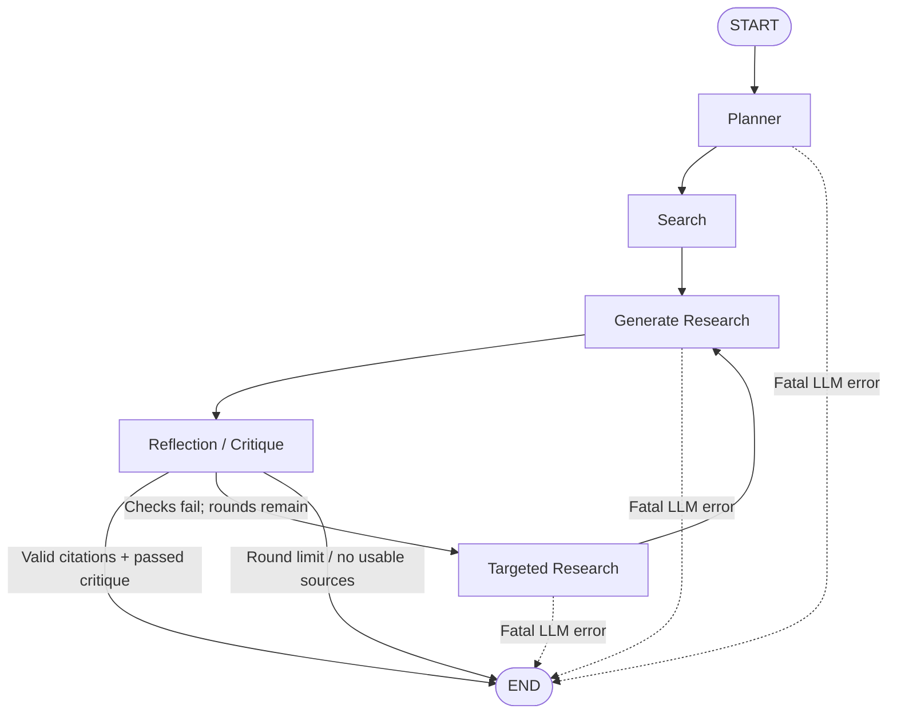

# Architecture

The researcher uses exactly five LangGraph nodes. Both the Streamlit UI and CLI call `agent.runner.run_research`, which owns one run's state, progress updates, elapsed time, and final result.

## Five-node graph

The conditional edge runs **after Reflection**, matching the implemented, approved flow. This ensures every stopping decision has a critique of the current report. Generation clears the previous critique before the new report is judged.

| Node | Responsibility |
| --- | --- |
| Planner | Return JSON containing a scope, subquestions, and 3–4 queries. |
| Search | Search through MCP, deduplicate URLs, rank with keyword overlap, read pages, and number usable sources. |
| Generate Research | Write a cited report from collected text; later visits use the previous report, critique, and new evidence. |
| Reflection / Critique | Judge evidence support and coverage in JSON, check citation numbers in Python, and record remaining issues. |
| Targeted Research | Turn critique gaps into 1–2 focused searches and add up to two new pages. |

## Stopping rules and quality criteria

Three criteria must pass for **`success`**:

1. **Citation validity:** Python verifies that every `[n]` belongs to a readable collected source.
2. **Evidence support:** the critique LLM judges whether claims are supported by their cited source text.
3. **Research coverage:** the critique LLM judges whether the question and planned subquestions are adequately answered.

The initial report uses **zero refinement rounds**. Each completed rewrite adds one round; searches, page reads, and critiques do not. The configured limit is clamped to 0–2, so the default run can produce at most three reports.

If checks still fail at the limit, the latest report is returned as **`limited`**, with a code-generated note in Limitations before References. No usable sources produces an insufficient-evidence result. A fatal LLM error also ends the run as limited, preserving the latest completed draft when one exists.

## Components and data flow

- `agent/state.py` contains the Pydantic plan, source, critique, and run-state models. Source numbers remain stable as evidence grows.
- `agent/prompts.py` contains all LLM prompt text. `agent/llm.py` uses the provider and model selected in `agent/config.py`.
- `agent/helpers.py` shares web collection between Search and Targeted Research. The defaults keep five initial pages and at most two new pages per targeted pass, each truncated to 1,000 characters.
- `mcp_service/client.py` starts `python -m mcp_service.server` using the caller's Python interpreter and the project root as its working directory. Module launch keeps package imports reliable.
- The official MCP SDK carries requests over local **stdio**. `search_web` returns title/URL/snippet items; `read_page` uses HTTPX and Trafilatura for HTML text. Failures return error data.
- `agent/config.py` resolves `.env` from the project root, independent of the terminal's working directory.
- The runner collects node-start events for UI progress. Token totals live in the run state, and elapsed time uses `perf_counter`.

## Recovery

Empty searches get one LLM-rephrased retry. Failed pages are skipped and logged. Malformed JSON gets one retry, with both replies' reported tokens counted. LLM rate limits and connection failures have bounded retries; rate-limited web tools also wait and retry.

Web tools log the search, fetch, content validation, and extraction stages. DDGS's generic no-result exception is reported as ambiguous rather than a confirmed empty return. Page fetch retries also cover selected transient 5xx and network/timeouts; an empty extraction gets one Trafilatura `favor_recall` pass. See [web research diagnostics](web_research.md) for configuration and live observations.

## Lessons from the saved development reports

The original milestone reports are preserved in [`examples/`](../examples/) as historical outputs:

- `report_1.md` is an early draft. Some inline numbers have no matching References entry; it is not a validated final answer.
- `report_2.md` and `report_3.md` include their two-round stopping notes and unresolved critique issues.
- Missing measurements in extracted text do not justify claiming that no published measurements exist.
- Short excerpts may omit important details, and valid citation numbers do not prove a claim is supported. The critique can also miss issues or flag valid claims.

Those reports discuss general LangGraph capabilities such as database-backed checkpointing and human review. This project uses in-memory run state and Streamlit session state. Groq and OpenRouter are selected explicitly; there is no automatic provider failover.
